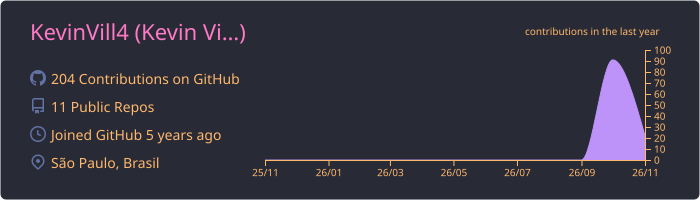
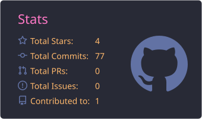
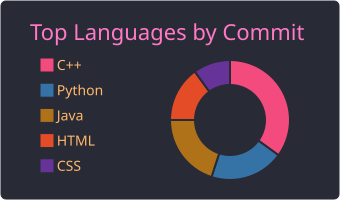
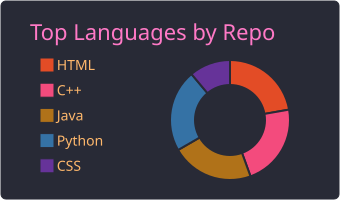
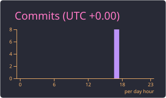

<!-- Header banner -->

  

<!-- Typing animation -->

  

  

---

## 👨‍💻 About me

- 💻 **Systems Analyst & Developer**
- 🌐 Building modern, fast web applications with **React**
- ☁️ Deploying and serving sites on **Cloudflare**
- 🖥️ Working with **IT infrastructure**, servers and monitoring
- ⚙️ Automating repetitive tasks with **Python**
- 🌱 Always learning and exploring new technologies
- 📫 Reach me on [LinkedIn](https://www.linkedin.com/in/kevin-vill4/) or by [email](mailto:kevin.oliveiravilla@gmail.com)

 

---

## 🛠️ Tech stack

  
   
  

  

---

## 📊 GitHub stats

  

  
  

  
  

  

---

## 🟡 Pac-Man contributions

  <picture>
    <source media="(prefers-color-scheme: dark)" srcset="https://raw.githubusercontent.com/KevinVill4/KevinVill4/output-pacman/pacman-contribution-graph-dark.svg">
    <source media="(prefers-color-scheme: light)" srcset="https://raw.githubusercontent.com/KevinVill4/KevinVill4/output-pacman/pacman-contribution-graph.svg">
    
  </picture>

<!-- Footer -->

  

